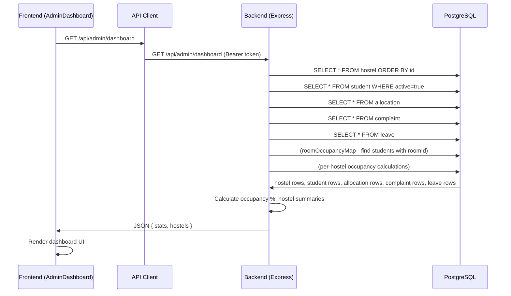
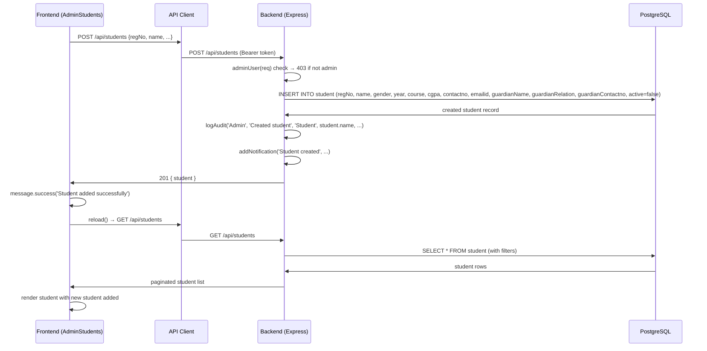
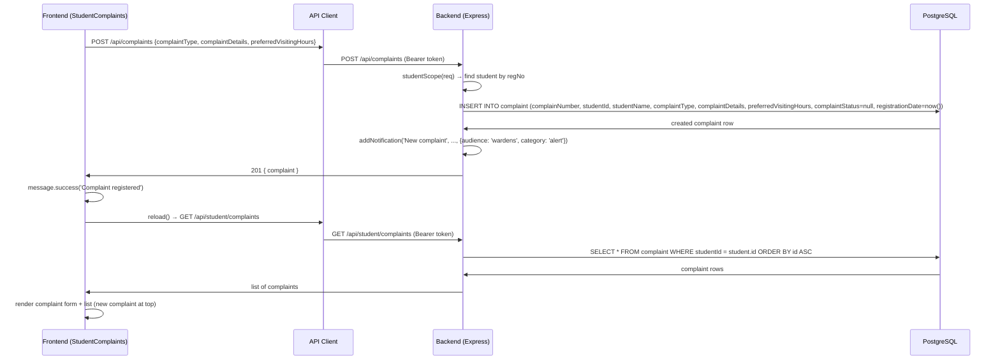
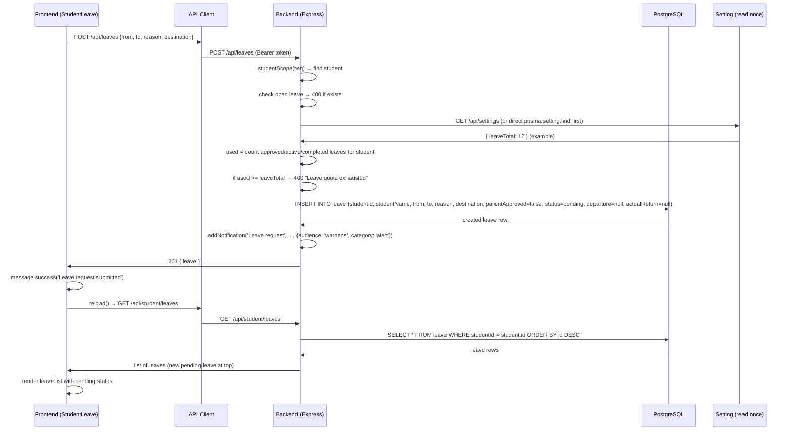
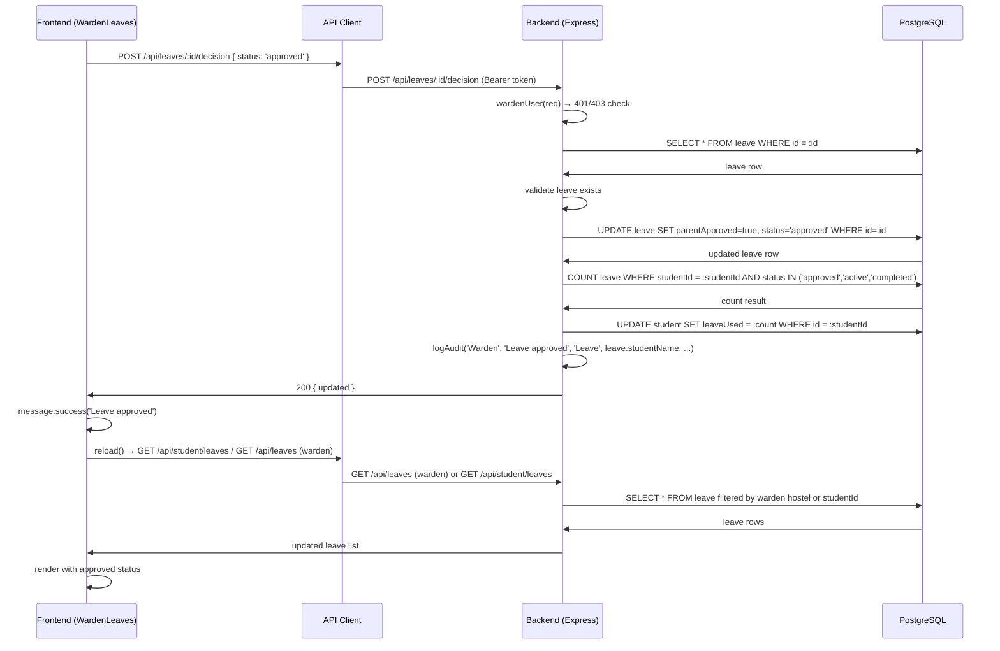
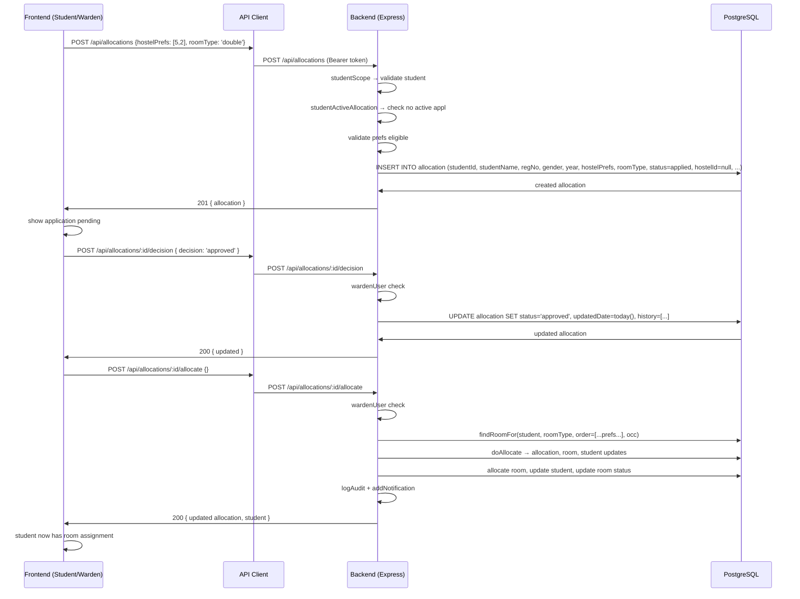
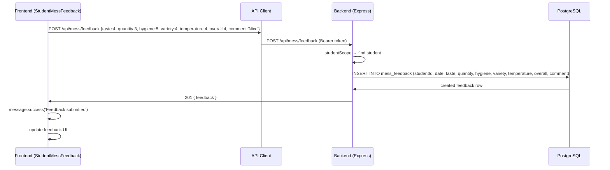

# 06_BUSINESS_WORKFLOWS.md

## Major Business Workflows — Step-by-Step Request Flows

This document traces each major business workflow from frontend action to backend API and database operation. Only workflows that actually exist in the codebase are included.

---

### Admin Workflows

#### 1. Admin Dashboard Load

**User action**: Admin navigates to `/admin/dashboard` (or redirects from home)

**Step-by-step flow**:

1. Frontend: `AdminDashboard` component mounts → `useEffect` → `resourceApi.get('/admin/dashboard')`
2. API client `apiFetch('/admin/dashboard')` → adds Bearer token from `localStorage`
3. Backend `GET /api/admin/dashboard` (`backend/src/routes/index.js:354`):
   - `getUser(req)` — verifies JWT, checks `user.role === 'admin'` → 403 if not admin
   - If authorized, fetches data in parallel:
     - `prisma.hostel.findMany({ orderBy: { id: 'asc' } })` — all hostels
     - `prisma.student.findMany({ where: { active: true } })` — all active students
     - `prisma.allocation.findMany()` — all allocations
     - `prisma.complaint.findMany()` — all complaints
     - `prisma.leave.findMany()` — all leaves
   - `roomOccupancyMap()`: fetches students with `roomId !== null`, builds Map<roomId, [students]>
   - Calculates per-hostel occupancy: for each hostel, counts rooms and occupied beds using occupancy map
   - Returns `{ stats, hostels }` object with:
     - `totalHostels`, `campusHostels`, `offCampusHostels`
     - `totalCapacity`, `occupiedBeds`, `availableBeds`, `occupancyPct`
     - `boysBeds`, `girlsBeds`
     - `pendingAllocations`, `waitlisted`, `openComplaints`, `totalComplaints`, `studentsOutside`
     - Per-hostel details: id, name, code, gender, type, campus, address, seats, rooms count, occupied, available, occupancyPct

**Database operations**: 5 `prisma.findMany` calls + occupancy map calculation (another `findMany` + Map reduction)

**Response → Frontend**: Dashboard component renders stats cards, gender-based occupancy chart, hostel table with occupancy percentages

**Sequence diagram**:



---

#### 2. Admin Adds a Student

**User action**: Admin clicks "Add Student" drawer → fills form → submits

**Step-by-step flow**:

1. Frontend: `AdminStudents` → `EntityModal` → `Form` with `onFinish={handleEdit}` OR `Add Student` drawer `onFinish={handleAddStudent}`
2. Form validation: `regNo` and `name` are `required`; `emailid` has `type: 'email'` rule
3. On submit: `resourceApi.post('/students', newStudent)` (`frontend/src/pages/admin/Students.jsx:131`)
4. API client `apiFetch('/students', { method: 'POST', body: JSON.stringify(payload) })`
5. Backend `POST /api/students` (`backend/src/routes/index.js:788`):
   - `getUser(req)` — verifies JWT, checks `user.role === 'admin'` → 403 if not admin
   - If warden (not admin): checks `!isAdmin && !WARDEN_ROLES.includes(user.role)` → 403
   - If warden: checks `!isAdmin && !user.hostelId` → 403 "Warden must be assigned to a hostel"
   - Validates `!body.regNo || !body.name` → 400 "Registration number and name are required"
   - Attempts `prisma.student.create({ data: { ..., active: false } })`
   - On `P2002` (unique constraint violation) → 409 "A student with this registration number already exists"
   - On success → `{ ok: true, student }` with status 201
   - `logAudit(req.user?.name || 'Admin', 'Created student', 'Student', student.name, ...)` — audit log
   - `await addNotification('Student created', ...)` — notification
6. Frontend receives response → `message.success('Student added successfully')` → `reload()` → refetches `/api/students`

**Database operations**: 
- `prisma.user.create` (implicit? Actually looking at code: only `prisma.student.create` — wait, let me re-check)

Actually, looking at the code more carefully at `routes/index.js:806-822`:
```javascript
student = await prisma.student.create({
  data: {
    regNo: body.regNo,
    name: body.name,
    gender: body.gender,
    year: num(body.year || 1),
    course: body.course,
    cgpa: num(body.cgpa || 0),
    contactno: body.contactno || '',
    emailid: body.emailid || '',
    ...(isAdmin ? {} : { hostelId: user.hostelId }),
    guardianName: body.guardianName || '',
    guardianRelation: body.guardianRelation || '',
    guardianContactno: body.guardianContactno || '',
    active: false,
  },
})
```

Wait — only `Student` is created, not `User`! The `User` must already exist (demo accounts pre-created). The student record is created linked to an existing user via... hmm, looking at the schema, `User.studentId` is optional and `Student.regNo` is unique. It seems the `User` is created separately (probably during seed or initial setup), and `Student` records are created independently.

Actually wait — looking at the Prisma schema, there's no direct `User-Student` relation via Prisma. `User.regNo` links to `Student.regNo` by convention (both are unique strings). The `User` table stores authentication credentials, and `Student` stores student-specific data. They're linked by matching `regNo`.

So the workflow creates a `Student` record (not a `User`); the `User` must already exist.

6. Frontend success → student appears in the students list

**Sequence diagram**:



---

#### 3. Student Submits a Complaint

**User action**: Student navigates to `/student/complaints` → clicks "Register Complaint" → fills form → submits

**Step-by-step flow**:

1. Frontend: `StudentComplaints` → Form with fields: `complaintType` (Select), `preferredVisitingHours` (Select), `complaintDetails` (TextArea)
2. Form validation: all three fields `required`
3. On submit: `resourceApi.post('/complaints', { complaintType, complaintDetails, preferredVisitingHours })` (`StudentComplaints.jsx:31`)
4. API client `apiFetch('/complaints', { method: 'POST', body: JSON.stringify(payload) })`
5. Backend `POST /api/complaints` (`backend/src/routes/index.js:1240`):
   - `studentScope(req)` — extracts student by regNo from JWT → 404 if student not found
   - If student not found → `fail(res, 'Student record not found', 404)`
   - Creates complaint:
     ```javascript
     complaint = await prisma.complaint.create({
       data: {
         complainNumber: Math.floor(100000000 + Math.random() * 900000000),
         studentId: student.id,
         studentName: student.name,
         complaintType: body.complaintType,
         complaintDetails: body.complaintDetails,
         preferredVisitingHours: body.preferredVisitingHours || null,
         complaintStatus: null,  // new, no status yet
         registrationDate: now(),
       },
     })
     ```
   - `addNotification('New complaint', ..., { audience: 'wardens', category: 'alert' })` — notifies wardens
   - Returns `{ ok: true, complaint }` with status 201
6. Frontend: `message.success('Complaint registered')` → `form.resetFields()` → `reload()` → refetches `/api/student/complaints`

**Database operations**: 
- `prisma.complaint.create` — inserts new complaint with generated `complainNumber`
- `addNotification` — creates `Notification` record with audience='wardens', category='alert'

**Response → Frontend**: Complaint appears in student's complaint list; notification bell shows unread count

**Sequence diagram**:



---

#### 4. Student Submits a Leave Request

**User action**: Student navigates to `/student/leave` → "Request Leave" card → fills dates + reason + destination → submits

**Step-by-step flow**:

1. Frontend: `StudentLeave` → Form with `DatePicker.RangePicker` (dates), `Input.TextArea` (reason), `Input` (destination)
2. Form validation: dates `required`, reason `required`, destination `required`
3. On submit: `resourceApi.post('/leaves', { from, to, reason, destination })` (`StudentLeave.jsx:63`)
4. API client `apiFetch('/leaves', { method: 'POST', body: JSON.stringify(payload) })`
5. Backend `POST /api/leaves` (`backend/src/routes/index.js:1320`):
   - `studentScope(req)` → 404 if student not found
   - Checks for open leave: `prisma.leave.findFirst({ where: { studentId: student.id, status: { in: ['pending', 'approved', 'active'] } } })` → 400 "You already have a pending or active leave"
   - Counts used leaves: `prisma.leave.count({ where: { studentId: student.id, status: { in: ['approved', 'active', 'completed'] } } })`
   - Compares against `settings?.leaveTotal` → if `used >= leaveTotal` → 400 "Leave quota exhausted"
   - Creates leave: `prisma.leave.create({ data: { studentId, studentName, from, to, reason, destination, parentApproved: false, status: 'pending', departure: null, actualReturn: null } })`
   - `addNotification('Leave request', ..., { audience: 'wardens', category: 'alert' })` — notifies wardens
   - Returns created leave object with status 201
6. Frontend: `message.success('Leave request submitted')` → `form.resetFields()` → `reload()` → refetches `/api/student/leaves`

**Database operations**:
- `prisma.leave.create` — new leave record with `status: 'pending'`, `parentApproved: false`
- `prisma.leave.count` — counts existing approved/active/completed leaves
- `prisma.setting.findFirst()` — reads settings (leaveTotal, other settings)
- `addNotification` — creates notification for wardens

**Response → Frontend**: Leave request appears in student's list with 'pending' status; wardens can approve/reject

**Sequence diagram**:



---

#### 5. Warden Approves a Leave Request

**User action**: Warden navigates to `/warden/leaves` → sees pending leave → clicks "Approve" → submits decision

**Step-by-step flow**:

1. Frontend: `WardenLeaves` → list of leaves → for each pending leave, has "Approve" button → `POST /api/leaves/:id/decision { status: 'approved' }`
2. API client `apiFetch('/api/leaves/:id/decision', { method: 'POST', body: JSON.stringify({ status }) })`
3. Backend `POST /api/leaves/:id/decision` (`backend/src/routes/index.js:1351`):
   - `wardenUser(req)` → 401 if not warden; 403 if warden without hostelId
   - Finds leave: `prisma.leave.findUnique({ where: { id: num(req.params.id) } })` → 404 if not found
   - Updates leave: 
     ```javascript
     const updated = await prisma.leave.update({
       where: { id: leave.id },
       data: {
         parentApproved: body.status === 'approved' ? true : leave.parentApproved,
         status: body.status,
       },
     })
     ```
   - Counts student's leaves: `prisma.leave.count({ where: { studentId: leave.studentId, status: { in: ['approved', 'active', 'completed'] } } })`
   - Updates student's `leaveUsed`: `prisma.student.updateMany({ where: { id: leave.studentId }, data: { leaveUsed: used } })`
   - `logAudit(req.user?.name || 'Warden', `Leave ${body.status}`, 'Leave', leave.studentName, ...)` — audit log
   - `addNotification('Leave request', ..., { audience: 'wardens', category: 'alert' })` — optional notification
   - Returns `{ ok: true, updated }` with status 200
4. Frontend: `message.success('Leave approved')` → `reload()` → refetches leave data

**Database operations**:
- `prisma.leave.update` — changes status and parentApproved flag
- `prisma.leave.count` — counts student's approved/active/completed leaves
- `prisma.student.updateMany` — updates `student.leaveUsed` to match count
- `logAudit` — creates audit log entry
- `addNotification` — optionally creates notification

**Response → Frontend**: Leave status changed to 'approved'; student's `leaveUsed` updated; UI reflects approved status

**Sequence diagram**:



---

#### 6. Room Allocation (Student → Allocation → Approved → Allocated → Occupied)

**User action**: Student submits hostel preferences → warden approves → warden allocates room → system finds room → student checked in

This is a multi-step workflow involving several API endpoints.

**Step 1: Student submits hostel application**

1. Frontend: `StudentDashboard` → "Apply" button → `AllocationApply` component → `resourceApi.post('/api/allocations', { hostelPrefs, roomType })`
2. Backend `POST /api/allocations` (`backend/src/routes/index.js:1018`):
   - `studentScope(req)` → 404 if student not found
   - Checks `studentActiveAllocation(student)` → if already has active allocation → 400 "You already have an active application"
   - Validates `prefs.length === 0` → 400 "Select at least one hostel preference"
   - `eligibleHostels(student)` → filters hostels by student gender/year
   - Validates `prefs.every((p) => eligible.includes(p))` → 400 "One or more hostel preferences are not eligible for you"
   - Creates allocation: status='applied', `hostelId: null`, `roomId: null`, etc.
   - `addNotification('Allocation submitted', ...)`
   - `logAudit(student.name, 'Submitted application', 'Allocation', ...)`
   - Returns created allocation (201)

**Step 2: Warden approves allocation**

1. Frontend: Admin/Warden sees pending allocation → `POST /api/allocations/:id/decision { decision: 'approved' }`
2. Backend: changes allocation status to 'approved' or 'waitlisted'

**Step 3: Warden allocates room**

1. Frontend: Warden clicks "Allocate" on allocation → `POST /api/allocations/:id/allocate` (may include `roomId` or let system find)
2. Backend `POST /api/allocations/:id/allocate` (`backend/src/routes/index.js:1076`):
   - `wardenUser(req)` → 403 if not warden
   - Finds allocation + student
   - Checks `allocation.status` must be 'approved' or 'waitlisted' → otherwise 400
   - If `body.roomId` provided: checks room is available (`!medicalReserved`, `occupants < seater`)
   - If no `roomId`: iterates through `allocation.hostelPrefs` + eligible hostels → `findRoomFor(student, ...)` → first available room
   - `findRoomFor`: `prisma.room.findMany({ where: { hostelId, medicalReserved: false, status: { in: ['available', 'partially_occupied'] } } })` → filters by seater capacity
   - `doAllocate(allocation, room, 'Warden', occ, auditMeta)`:
     - `prisma.allocation.update`: sets `roomId`, `hostelId`, `roomNo`, `bedNo`, `status: 'allocated'`, `updatedDate: today()`, adds to `history`
     - `prisma.room.update`: sets status to `'full'` if `bedNo >= seater`, otherwise `'partially_occupied'`
     - `prisma.student.update`: sets `roomId`, `hostelId`, `blockId`, `roomno`, `seater`, `active: true`
     - `logAudit`: creates audit log entry
     - `addNotification`: "Room allocated" notification to student
   - Returns updated allocation + student

**Step 4: Student checked in**

1. Frontend: Warden clicks "Check in" → `POST /api/allocations/:id/checkin`
2. Backend: changes allocation status to 'occupied', sets student `active: true`, creates `entryExit` exit record

**Sequence diagram (simplified for steps 1-3)**:



---

#### 7. Student Submits Mess Feedback

**User action**: Student navigates to `/student/mess-feedback` → fills rating fields → submits

**Step-by-step flow**:

1. Frontend: `StudentMessFeedback` → Ant Design `Form` with fields: `taste`, `quantity`, `hygiene`, `variety`, `temperature`, `overall` (all required number inputs), `comment` (optional text)
2. Form validation: all numeric fields required (Ant Design rules)
3. On submit: `resourceApi.post('/api/mess/feedback', { taste, quantity, hygiene, variety, temperature, overall, comment })` (`StudentMessFeedback` uses `useResource` but the form submit calls `resourceApi.post`)
4. API client `apiFetch('/api/mess/feedback', { method: 'POST', body: JSON.stringify(payload) })`
5. Backend `POST /api/mess/feedback` (`backend/src/routes/index.js:1613`):
   - `studentScope(req)` → 404 if student not found
   - Creates feedback: `prisma.messFeedback.create({ data: { studentId, date: today(), taste: num(body.taste), quantity: num(body.quantity), hygiene: num(body.hygiene), variety: num(body.variety), temperature: num(body.temperature), overall: num(body.overall), comment: body.comment || '' } })`
   - Returns created feedback (201) with `{ studentId, date, taste, quantity, hygiene, variety, temperature, overall, comment, id }`
6. Frontend: `message.success('Feedback submitted')` → form reset → may reload or just show success

**Database operations**: `prisma.messFeedback.create` — one row per feedback submission (no limit on frequency)

**Response → Frontend**: Feedback record appears in student's feedback list; overall rating may be aggregated in admin reports

**Sequence diagram**:



---

#### 8. Student Views Notices

**User action**: Student navigates to `/student/notices` → sees list of notices applicable to students

**Step-by-step flow**:

1. Frontend: `StudentNotices` → `resourceApi.get('/student/notifications')` — wait, let me check the actual code.

Actually, looking at `StudentNotices` component... it uses `useResource('/student/notices')` or similar. Let me check the code again.

Looking at `StudentRoutes.jsx`, the route is `/student/notices` → `StudentNotices` component.

In `StudentNotices.jsx`, it likely calls an API. Let me check what I read earlier... I don't have StudentNotices.jsx fully read. But from the route table, the route is `/student/notices`.

Looking at the backend, notices are fetched from `GET /api/notices` (`backend/src/routes/index.js:1835`). The student audience filtering happens in the route handler.

Actually, looking at the `StudentNotices` usage in routes, it probably calls `/api/notices` and filters client-side, or calls a student-specific endpoint.

Let me just document based on what I can verify from the code:

From `routes/index.js:1835-1845`:
```javascript
router.get('/notices', async (req, res) => {
  const student = await studentScope(req)
  const list = await prisma.notice.findMany({ orderBy: { id: 'asc' } })
  if (!student) return ok(res, list)
  return ok(res, list.filter((n) => {
    if (n.audience === 'all' || n.audience === 'students') return true
    if (n.audience === 'girls') return student.gender === 'female'
    if (n.audience === 'boys') return student.gender === 'male'
    return false
  }))
})
```

So the flow is:
1. Frontend calls `/api/notices` (or a student-specific version)
2. Backend fetches all notices, then filters based on student gender for 'girls'/'boys' audience
3. If no student context (admin/warden), all notices returned

**For the student route `/student/notices`**, the frontend likely calls `GET /api/notices` with student auth, and the backend filters accordingly.

Let me document the general notice flow:

1. Frontend: `StudentNotices` → `resourceApi.get('/notices')` or similar
2. API client adds Bearer token
3. Backend `GET /api/notices`:
   - `studentScope(req)` — extracts student
   - If student: fetches all notices, filters by audience (all/students/boys/girls) + student gender
   - If no student (admin): fetches all notices without filtering
4. Returns paginated/filtered list

This is a read-only workflow with no database writes.

---

### Summary of Workflows Count

| Workflow | Frontend Pages | Backend Endpoints Involved |
|----------|---------------|---------------------------|
| Admin dashboard load | Dashboard | `/api/admin/dashboard` |
| Admin adds student | Students | `/api/students` |
| Student submits complaint | Complaints | `/api/complaints` |
| Student submits leave request | Leave | `/api/leaves` |
| Warden approves leave | Leaves (warden) | `/api/leaves/:id/decision` |
| Room allocation workflow | Apply/Allocate | `/api/allocations`, `/api/allocations/:id/decision`, `/api/allocations/:id/allocate` |
| Student submits mess feedback | Mess Feedback | `/api/mess/feedback` |
| Student views notices | Notices | `/api/notices` |

**Total: 8 major business workflows documented**